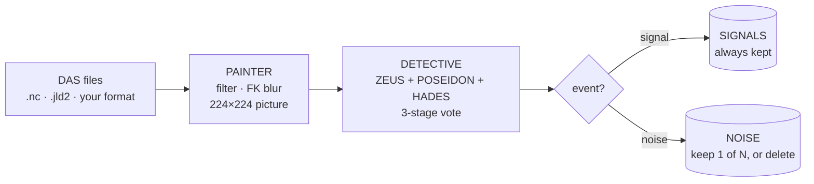

<p align="center">
  
</p>

<h1 align="center">DASight.jl</h1>

<p align="center">
  <b>Visual machine learning for Distributed Acoustic Sensing (DAS) data</b><br>
  <i>Turn DAS records into pictures. Let trained ResNets tell you which ones contain events.</i>
</p>

<p align="center">
  <a href="https://github.com/marianoarnaiz/DASight.jl/actions/workflows/CI.yml"></a>
  
  
  <a href="LICENSE"></a>
</p>

---

## What is DASight?

DAS systems record continuously, often **more than a terabyte per day**, and in most monitoring
scenarios only a small fraction of that contains seismic signals of interest. DASight helps you
**keep the events and discard (or thin out) the noise**.

It does one simple thing, on purpose: *"can I see an event in this file? yes / no."*
Each DAS file is filtered and plotted as a small 224×224 picture, and trained convolutional
neural networks (ResNets) classify the picture as **signal** or **noise**. No picking, no
localisation, no magnitudes: a featherweight screening tool that reduces data volume while
preserving the recordings that matter.

- **Live monitoring**: screen files as the acquisition system writes them.
- **Archives**: find the event-containing files in old data sets.
- **Easy to plug in**: file-based, with simple shell launchers and a plain Julia API.
- Built on [DASvader.jl](https://github.com/marianoarnaiz/DASvader.jl), IPGP's open-source
  Julia package for DAS data handling and signal processing.

> DASight was created as part of the TRANSFORM² project. It was previously distributed as
> **T2-DASight**; this repository is its installable successor.

## How it works



| Step | What it does | Example folder |
|:--|:--|:--|
| **1. PAINTER** | Reads your data and paints a picture of each file: removes mean/trend, normalises channels, band-passes around the dominant low-frequency band, blurs with an FK-peak-sized Gaussian, and renders a `RdBu` heatmap with automatic contrast. | `1_PAINTER` |
| **2. DETECTIVE** | Classifies a folder of pictures with three trained networks (**ZEUS**, **POSEIDON**, **HADES**) and combines them with a 3-stage weighted vote. Writes lists of signal and noise files. | `2_DETECTIVE` |
| **3. WATCHER** | Does 1 and 2 continuously on a folder that receives live data, keeps signal files, and applies *your* noise policy (keep all, keep 1 in 10, keep 1 in 100, or none). | `3_WATCHER` |

## Installation

**Requirements:** Julia ≥ 1.10 (developed and checked on 1.12), macOS or Linux (Windows is untested),
an internet connection, and a few GB of disk (Julia packages plus the models).

**1. Install Julia** (skip if you have it; see <https://julialang.org/downloads/>):

```bash
curl -fsSL https://install.julialang.org | sh
```

**2. Install DASight** in its own shared environment. Start `julia`, press `]` to enter the
package manager, and run:

```julia
activate --shared DASight
add https://github.com/anowacki/Geodesics.jl https://github.com/anowacki/Seis.jl https://github.com/marianoarnaiz/DASvader.jl https://github.com/marianoarnaiz/DASight.jl
```

All four are given in one command because DASvader and its dependencies are not (yet) in Julia's
General registry. The machine-learning packages that must be pinned to specific versions
(Flux 0.14.25, Metalhead 0.9.5, MLUtils 0.4.5) are handled for you (we are working on this). The first install and the
first `using DASight` take a while: Julia is compiling a large plotting and ML stack.

**3. Get the examples.** Back in the normal Julia prompt (press backspace to leave package mode):

```julia
using DASight
DASight.install_examples("~/DASight_examples")
```

This copies the three examples and a small example data set to a folder you can edit.
The trained models (a few hundred MB) are downloaded automatically, once, the first time they are used.

## Quick start

```bash
cd ~/DASight_examples/1_PAINTER
./run_painter.sh data_test                      # data  →  pictures (in ./DASight_pics)

cd ../2_DETECTIVE
./run_detective.sh ../1_PAINTER/DASight_pics   # pictures  →  lists of signals and noise
```

If a launcher says *permission denied*, run `chmod +x *.sh` in that folder once (or start it with `bash run_painter.sh`).
The launchers look for DASight in the `@DASight` environment from step 2; to use another one:
`DASight_ENV=/path/to/env ./run_painter.sh ...`.

## The three examples

### 1. PAINTER: learn to get your data in

```bash
./run_painter.sh /path/to/folder_with_nc_files [output_folder] [--keep-originals]
```

Writes one `<name>_RdBu_0_AUTO.png` per file. Open `DAS2Pics_nc.jl` and edit the settings
block at the top (the names of the variables in your files). The script is short and commented on
purpose: it is the place to learn how a data file becomes a DAS object in Julia.

### 2. DETECTIVE: find events in a set of pictures

```bash
./run_detective.sh image_folder [output_folder] [models_folder]
```

Writes, in the output folder (`<tag>` is the name of the image folder):

| File | Content |
|:--|:--|
| `found_signals_<tag>.txt` | pictures decided **SIGNAL** |
| `found_noise_<tag>.txt` | pictures decided **NOISE** |
| `others_<tag>.txt` | pictures where the three models disagreed (for manual review) |
| `pipeline_output_<tag>.txt` | score, votes and decision for every picture |
| `Results_<tag>.txt` | class and probability from each model |

Thresholds and model weights are in the settings block of `Pics2Events.jl`.

### 3. WATCHER: live classification

Use two terminals. In the first, simulate an instrument (it copies a file into `DAS_RECORDING` every 10 s):

```bash
./start_recording.sh Fake_DAS DAS_RECORDING 10
```

In the second, watch that folder:

```bash
./run_watcher.sh DAS_RECORDING --keep-noise 10
```

Every new file is turned into a picture, classified, and **moved out of the folder**:
signals to `SIGNALS/`, noise to `NOISE/` or deleted, unreadable files to `FAILED/`, and every
decision is appended to `watcher.log`. The models are loaded once and stay in memory.

| `--keep-noise` | What happens to noise files |
|:--|:--|
| `1` *(default)* | keep **all** of them |
| `10` | keep 1 of every 10 |
| `100` | keep 1 of every 100 |
| `0` | keep **none**: noise files are **deleted** |

Other options: `--keep-pics` (keep the `_AUTO` pictures in `PICS/`), `--models DIR`, `--once`
(process what is waiting and exit). The 1-in-N count continues across restarts.

> WARNING: With `--keep-noise` other than `1`, data is **permanently deleted**. Try it on a copy first.

## Using your own data

Everything in DASight works on a DASVader `iDAS` object:

```julia
dDAS = iDAS(data, timee, htime, offset, atrib, filename)
```

| Argument | What | Note |
|:--|:--|:--|
| `data` | `Matrix` of the measurements | **time samples × channels**: orientation matters |
| `timee` | time axis in seconds | length = number of rows of `data` |
| `htime` | `Vector{DateTime}` | length = number of rows of `data`; metadata |
| `offset` | channel positions in metres | length = number of columns of `data` |
| `atrib` | `empty_attb()` | metadata, not used by DASight |
| `filename` | `String` | |

Ready-made readers: `read_das_nc` (NetCDF, any variable names, either orientation) and
`read_das_jld2` (DASVader files). For other formats write a small function that returns an `iDAS`, then check it:

```julia
using DASight
dDAS = read_das_nc("myfile.nc"; data_var="StrainRate", offset_var="offset", time_var="time")
check_das(dDAS)      # prints sampling rate, duration, spacing; warns about the usual mistakes
```

If `check_das` ends with **✓ data looks well read**, the rest of DASight will work on it.

## Using DASight as a library

```julia
using DASight

# data → picture
dDAS = read_das_nc("myfile.nc")
das2pics(dDAS; label="myfile.nc", outdir="pics")
batch_auto_level_intensity(dir="pics", remove_original=true)

# pictures → decision
models = load_detective_models(models_dir(),
             (zeus="ZEUS.bson", poseidon="POSEIDON.bson", hades="HADES.bson"))
results, decision = detect_files(list_images("pics"), models)
# decision[:, 1] = file, decision[:, 5] = "SIGNAL" / "NOISE"
```

Every function has a docstring: use `?das2pics`, `?run_pipeline`, `?watch`, and so on.

## Models and example data

The trained models and the example data are too large for git. They are hosted on Zenodo
(**DOI: _to be added_**) and downloaded, verified and cached by Julia the first time they are needed.
To use your own copies (for example offline), set `DASight_MODELS_DIR` and `DASight_DATA_DIR`.

## Status and roadmap

DASight is at an early stage (**v0.1**). The user manual is in preparation. Planned:

- an HDF5 (`.h5`) reader alongside the NetCDF one
- tiling of very large files into windows before painting
- a guide (and scripts) to retrain the networks, for other event classes or other kinds of monitoring
- Windows testing, and registration in Julia's General registry once DASvader is registered

Issues and suggestions are welcome.

## Citation

If you use DASight, please cite it (see [`CITATION.cff`](CITATION.cff); GitHub's *Cite this repository* button uses it).

## Authors

**Mariano S. Arnaiz-Rodríguez** and **Claudio Satriano**
Université Paris Cité, Institut de physique du globe de Paris, CNRS, F-75005 Paris, France

Created as part of the TRANSFORM² project.

## License

MIT, see [`LICENSE`](LICENSE).
